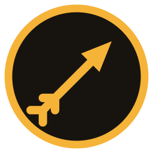

# AmmoFinder

**Walk into town, find the ammo vendor.**

---

Running out of arrows or bullets in the middle of nowhere is a hunter rite of passage. AmmoFinder makes sure it happens less: when you walk into a town or city that has an ammo vendor, a banner in the style of Regions of Azeroth's zone titles tells you who sells ammo, where they stand, and how much you have left. One click on **Point me there** puts a waypoint on your map.

## Features

- **A banner when you arrive.** The vendor's name and area, your ammo count, and a **Point me there** button that sets a map waypoint (or type `/ammo go`).
- **Only the ammo you use.** Bows and crossbows get arrow vendors, guns get bullet vendors. Nothing shows without a ranged weapon, unless you want it to.
- **Only the ammo you want.** Any ammo for your weapon, only the best ammo for your level (Rough, Sharp, Razor, Jagged Arrows; Light, Heavy, Solid Shot, Accurate Slugs), or exactly the kinds you tick.
- **Low ammo warning.** The banner turns red and says *Low on Ammo!* or *Out of Ammo!* below a count you choose.
- **No spam.** The same town is not announced again for a while (10 minutes by default, your choice).
- **111 vendors built in.** Every Classic capital and town vendor that sells arrows or bullets, with what they sell, from warcraft.wiki.gg and Wowhead Classic.
- **Learns as you play.** Open any vendor that sells arrows or bullets and AmmoFinder remembers them, their stock and where they are.

## Settings

Type `/ammo`, or open *Options > AddOns > AmmoFinder*.

| Setting | Default | What it does |
| --- | --- | --- |
| Enabled, Banner on screen, Message in chat, Play a sound | on, on, on, off | What AmmoFinder shows when you arrive |
| Also without a bow, crossbow or gun | off | Announce vendors even with no ranged weapon equipped |
| Show the banner for | 6 sec | How long the banner stays up (2 seconds more when you are low on ammo) |
| Same place again after | 10 min | How long before the same town or city is announced again. 0 announces it every time |
| Low ammo warning below | 200 | Below this count the banner turns red. 0 turns the warning off |
| Banner distance from the top | 260 px | Moves the banner up or down, so it does not cover the game's zone text |
| Which ammo | Any ammo for my weapon | *Any ammo for my weapon*, *Only the best ammo for my level*, or *Only the ammo I tick below* |

**Show a test banner** (or `/ammo test`) shows an example banner, to try out the length and position.

## Commands

| Command | |
| --- | --- |
| `/ammo` | Open the settings |
| `/ammo go` | Set a waypoint to the last announced vendor |
| `/ammo check` | Look for a vendor here now, ignoring the timeout |
| `/ammo test` | Show a test banner |
| `/ammo on` / `off` | Turn AmmoFinder on or off |
| `/ammo banner` / `chat` / `sound` / `always` | Toggle those settings |
| `/ammo list` | List the vendors you have learned |

## Supported game versions

| Game version | Patch | TOC file |
| --- | --- | --- |
| WoW Forever | 1.60.1 | `AmmoFinder_Camelot.toc` (and `AmmoFinder.toc`) |
| Classic Era | 1.15.9 | `AmmoFinder_Vanilla.toc` |

The game loads the right `.toc` file for the client you are playing on.

## Installation

1. Download the latest `AmmoFinder-vX.Y.Z.zip` from [GitHub Releases](https://github.com/xibate/Ammofinder/releases/latest).
2. Extract it into your AddOns folder, for example `World of Warcraft\_forever_\Interface\AddOns\`.
3. You should end up with `Interface\AddOns\AmmoFinder\AmmoFinder.toc`.
4. Restart the game or type `/reload`.

## Known limitations

- Forever reshaped the Stormwind, Redridge, Eastern Plaguelands and Mulgore maps, so waypoints there can be a little off.
- Vendor stock comes from Wowhead Classic. Vendors you learned before 0.4.0 have no stock saved, so they are announced whatever ammo you picked, until you open their window again.
- A learned vendor's position is where you stood when you opened their window.

## Development

- `AmmoFinder/` is the addon folder. `Data.lua` has the vendors and ammo, `AmmoFinder.lua` the banner and logic, `Options.lua` the settings and `Theme.lua` the look, shared with Crescendo and Easy Delete.
- `node tools/gen_icons.js` redraws `AmmoFinder/Media/Icon.tga` and `.github/icon.png`.
- `cd tests && npm install && npm test` runs the addon against a mock of the WoW API. It does not replace trying it in game.
- Releases: run *Publish Addon to CurseForge* from the Actions tab, or push a tag like `v0.4.0` matching `## Version` in `AmmoFinder/AmmoFinder.toc`. It needs a `CF_API_KEY` secret and a `## X-Curse-Project-ID` line in the `.toc` files once the CurseForge project exists.

## Changelog

### 0.4.0
- Settings window (`/ammo`) and a page in *Options > AddOns*, in the style of Crescendo and Easy Delete.
- New settings: how long the banner shows, how long before the same place is announced again, banner position, low ammo count.
- Pick your ammo: any ammo, only the best ammo for your level, or the kinds you tick. Every built-in vendor now knows which of the eight vendor ammo items they sell (from Wowhead Classic), and learned vendors remember their stock.
- The banner says which of your ammo the vendor sells.
- More room around the **Point me there** button: the banner now grows to fit its text, with a clear gap above and below the button.
- The banner sits lower by default so it no longer covers the zone name.
- Removed Mazk Snipeshot (Booty Bay): Wowhead does not list him selling any ammo.
- New icon, and the repository set up like the other addons: `.pkgmeta`, release workflow, Classic Era `.toc`.

### 0.3.0
- New banner: icon, gold title, divider, vendor and area line, ammo count line, and a **Point me there** button.
- Low ammo warning, learned vendors no longer duplicated, swapping between bow and gun re-checks.
